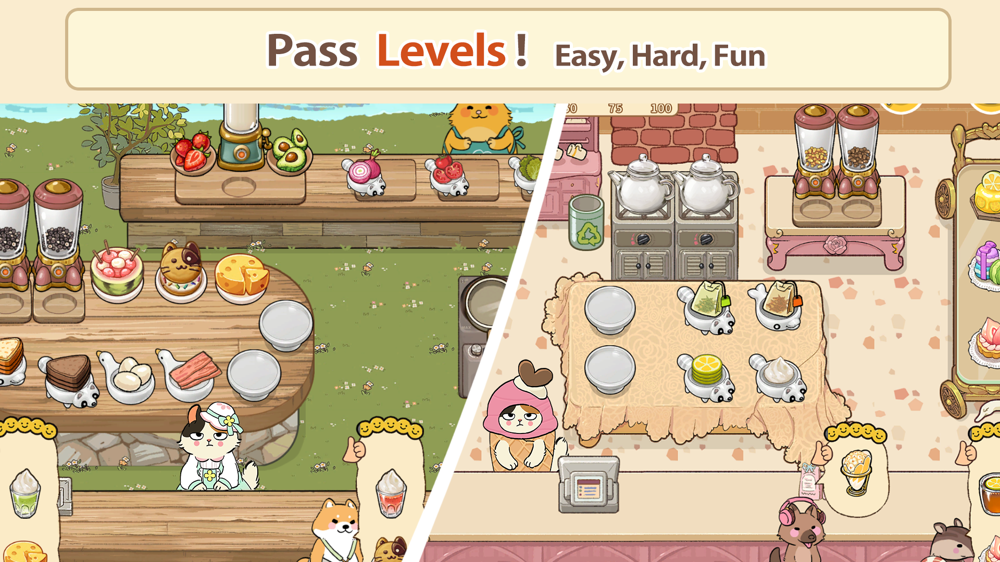
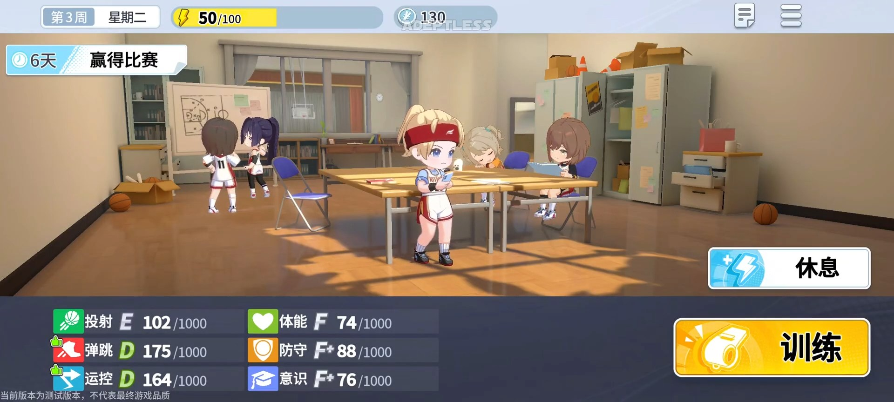
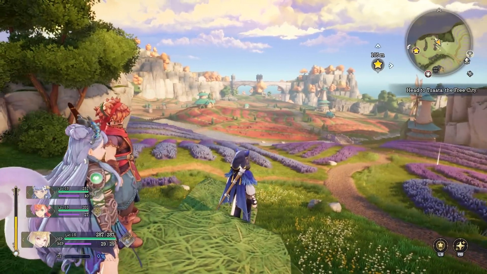
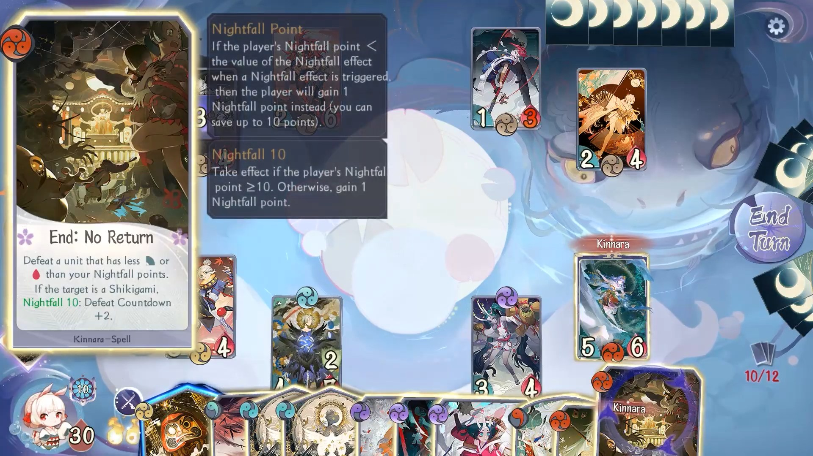
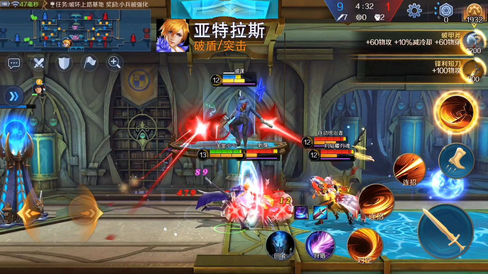
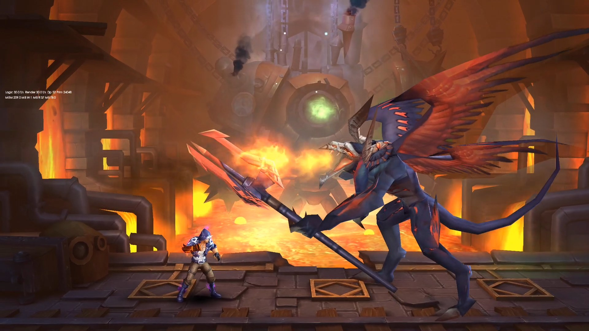
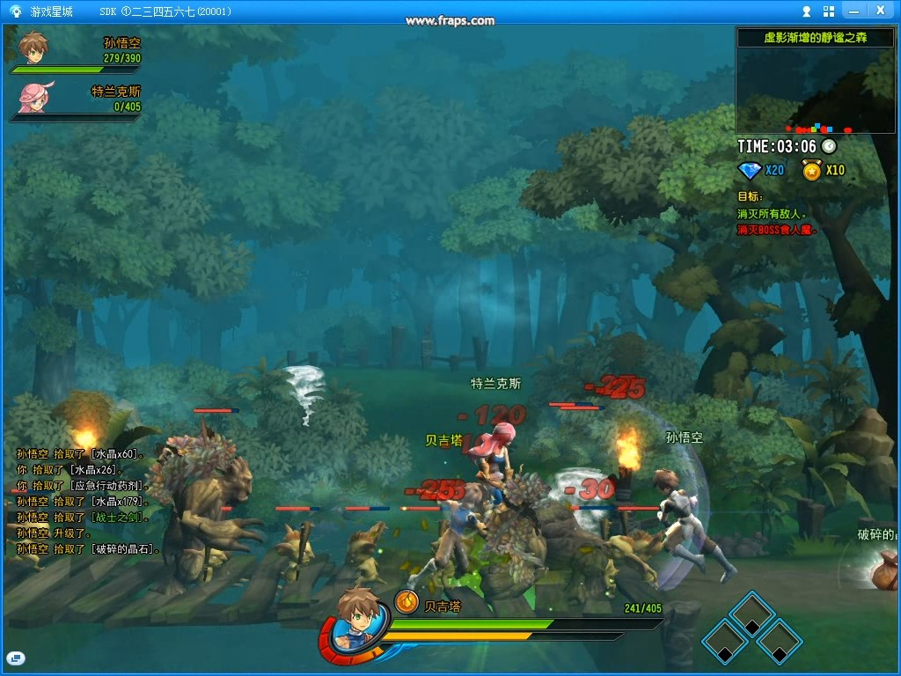
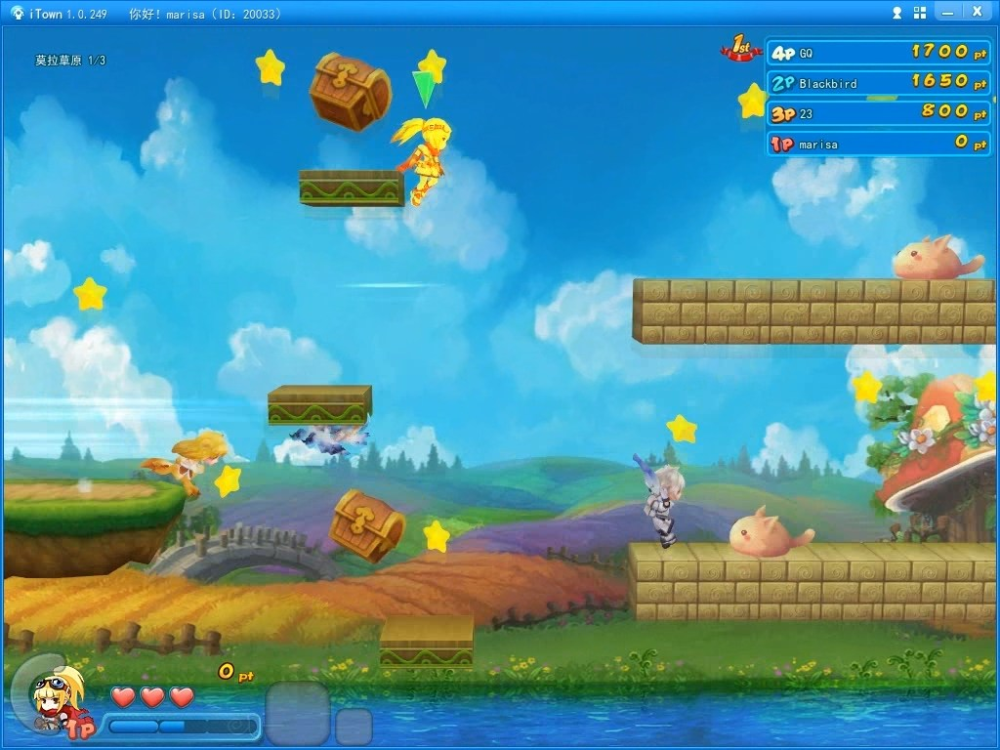
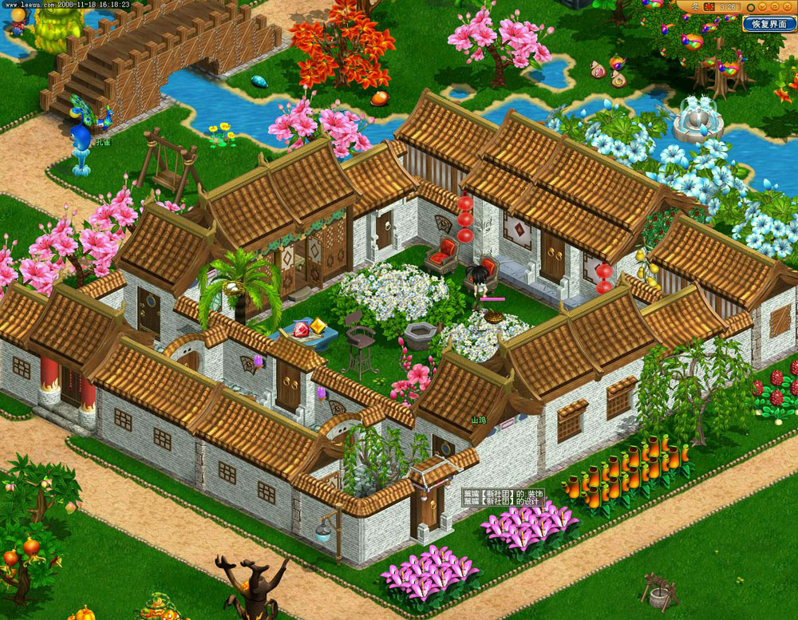

---
title:
date: "2024-05-04"
gallery: true
---

## About Me

**Senior Game Engineer — Gameplay, Multiplayer, Unity, Unreal, C++**

I am a game engineer with over **15 years of professional experience** building commercial games for **PC, mobile, Web, and console**. My work spans action games, ARPGs, CCGs, simulation games, and live-service titles, from early architecture and prototyping through launch and long-term operation.

I specialize in **gameplay and combat systems, multiplayer networking, game architecture, AI, development tools, and production pipelines**. I work primarily with **C++, C#, Python, Unity, Unreal Engine, and proprietary C++ engines**.

I have built multiple projects from the ground up and led engineering teams of up to six developers, including architecture and code review, mentoring, hiring, planning, and close collaboration with design, art, production, and server teams.

I also care deeply about how games *feel*, not only how they are implemented. I have spent thousands of hours with games such as *Street Fighter V*, *Elden Ring*, *Cyberpunk 2077*, and *Baldur's Gate 3*, and I bring that player perspective into gameplay and engineering decisions.

## Core Expertise

- **Gameplay & Architecture:** Game Architecture, Gameplay Systems, Combat, Character Controllers, AI, Animation
- **Multiplayer:** Client/Server, State Synchronization, Deterministic Lockstep, Replay Systems, Networked Combat
- **Engines & Languages:** Unity, Unreal Engine 4/5, proprietary C++ engines | C++, C#, Python, Lua
- **Tools & Pipelines:** Editor Tools, Live Update Systems, CI/CD, Localization, Build Automation

## Career

- [LingXi Games of Alibaba Group](https://www.alibabagroup.com/en-US/about-alibaba-businesses-1496656377454526464) — Senior Engineer
- [NetEase Games](https://www.neteasegames.com/) — Senior / Lead Engineer

## Selected Projects

### Purr-fect Chef: Cats Can Cook

[App Store](https://apps.apple.com/us/app/purr-fect-chef-cats-can-cook/id1603186963) | [Google Play](https://play.google.com/store/apps/details?id=com.gameplus.teaapp&hl=en_US) | [Steam](https://store.steampowered.com/app/3510590/) | [Reddit](https://www.reddit.com/r/PurrfectChef/s/uXG9wC7TO8) | [Jest](https://jest.com/g/purr-fect-chef)

**Role:** Senior Game Engineer  
**Technology:** Unity, C#, Nakama  
**Platforms:** Mobile | PC (Steam) | Web (Reddit, Jest)

A new cross-platform *Purr-fect Chef* title built from scratch in Unity. I established the project architecture and core systems before expanding development with the engineering team.

**Highlights:**

1. Built the game architecture and core systems from scratch in Unity.
2. Designed resource and script patching that supports code and content hot updates without a new store submission.
3. Led deployment across mobile, PC (Steam), and Web platforms (Reddit and Jest).
4. Designed the multiplayer architecture and online gameplay foundation, currently under development.
5. Built AI-assisted localization/content workflows and contributed to shared cross-platform casual-game infrastructure.

### Basketball Girls: AIM FOR THE SKY

[Gameplay](https://www.youtube.com/watch?v=gb1K52Zx5ok)

**Role:** Senior Engineer  
**Technology:** Unity, C#, Lua  
**Platform:** Mobile

A character-management game built around story-driven progression. I joined early and focused on the story-production pipeline, character presentation, UI scripting, animation, and physics integration.

**Highlights:**

1. Built the story-production toolchain, including story flow, dialogue authoring, Timeline editing, and runtime story systems.
2. Worked with technical artists on cel-shaded 3D characters, facial animation, asset standards, and physics-driven hair using Magica Cloth.
3. Built the Lua UI scripting framework with data binding.
4. Extended Unity Timeline with flow control, tweening, runtime activation, and Lua integration.

### Sakura Studio — Multiplayer Action R&D / Visions of Mana

[Gameplay](https://youtu.be/9biJipMQ-9Y) | [Steam](https://store.steampowered.com/app/2490990/_Visions_of_Mana/)

**Role:** Lead Multiplayer Engineer  
**Technology:** Unreal Engine 4, C++, Python, GAS  
**Platforms:** PC, PlayStation, Xbox

Shared Unreal Engine R&D supporting multiple console action projects at NetEase Sakura Studio. I led the multiplayer team and focused on reusable combat/networking infrastructure and Python gameplay scripting.

**Highlights:**

1. Led a four-engineer multiplayer team and architected a reusable GAS-based networked combat framework.
2. Prototyped multiplayer modes and experimental synchronization/rollback techniques for action gameplay.
3. Maintained and optimized the studio's Unreal Python integration.
4. Ported the Python runtime to PS4/PS5 so high-level gameplay scripts could execute directly on console.
5. Supported Python gameplay scripting across four studio projects, including collaborations with Square Enix, Bandai Namco, and TYPE-MOON.

### Onmyoji: The Card Game

[Gameplay](https://youtu.be/8XSc2hGH3Ak) | [Narrative](https://youtu.be/TiPahqEEc9Q)

**Role:** Lead Client Engineer  
**Technology:** NeoX, C++, Python  
**Platforms:** Mobile, PC

A commercial strategy card game in the *Onmyoji* universe. I built the client architecture from scratch and led the six-engineer client team from early development through launch.

**Highlights:**

1. Owned client architecture, technical planning, code review, and delivery across gameplay, UI, narrative, tools, replay, and live-service systems.
2. Built card and battlefield presentation using 3D rendering, Spine animation, CRIWARE video textures, and custom shaders.
3. Developed the story runtime, battle recording/playback, player-shared replays, and real-time spectating.
4. Established Jenkins CI, automated iOS/Android/PC builds, and a weekly client patching workflow.
5. Integrated in-game livestreaming and real-time social interaction.

### Soul and Machine

[Gameplay](https://youtu.be/wGAwF4LlvWY)

**Role:** Lead Engineer  
**Technology:** NeoX, C++, Python  
**Platform:** Mobile

A 4v4 side-scrolling action MOBA. I led a five-engineer programming team through prototype and TestFlight development.

**Highlights:**

1. Designed the ECS-based architecture and deterministic combat simulation.
2. Built fixed-step deterministic lockstep synchronization.
3. Developed command-stream recording/replay and desync tooling.
4. Built networked combat for player characters, NPC soldiers, projectiles, and battlefield structures.
5. Led development of character-action and level-design tools.

The project was discontinued after two iOS TestFlight rounds.

### The Phantom Soul

[Gameplay](https://youtu.be/mKkVkG_UrrY)

**Role:** Lead Engineer  
**Technology:** NeoX, C++, Python  
**Platform:** Mobile

A side-scrolling multiplayer ARPG supporting four-player cooperative dungeons and 1v1 PvP. I led a four-engineer programming team and designed the project's core gameplay and networking architecture.

**Highlights:**

1. Designed the core game architecture and client/server multiplayer architecture.
2. Developed the character controller, combat system, and multiplayer state synchronization.
3. Built behavior-tree AI, companion systems, character-authoring tools, and special-skill gameplay.
4. Shipped separate mainland-China and Hong Kong/Taiwan versions.
5. Supported the title through approximately three years of commercial operation.

## Earlier Projects

### Chronicles of Crystal

[Gameplay](https://youtu.be/dE_K94Xy76E)

**Role:** Gameplay / Multiplayer Engineer  
**Technology:** NeoX, C++, Python  
**Platform:** PC

A four-player cooperative side-scrolling action game released on NetEase's iTown platform.

**Highlights:** Multiplayer synchronization and combat, collision detection, AOI, gameplay systems, and level-editor tooling.

### Windy Island

[Gameplay](https://youtu.be/WnF3DK0E0WM)

**Role:** Gameplay / Multiplayer / Tools Engineer  
**Technology:** NeoX, C++, Python  
**Platform:** PC

A side-scrolling multiplayer racing game for up to four players.

**Highlights:** Gameplay and race-combat features, character synchronization, and level-design tooling.

### Romantic Country

[Gameplay](https://youtu.be/GPf5Xa5EeUw)

**Role:** Gameplay Programmer  
**Technology:** C++  
**Platform:** PC

A multiplayer simulation game centered on farming, housing, social interaction, and user-generated content.

**Highlights:** Developed core gameplay features and contributed to the in-game house-design system. The title remained in commercial operation for approximately 10 years.
